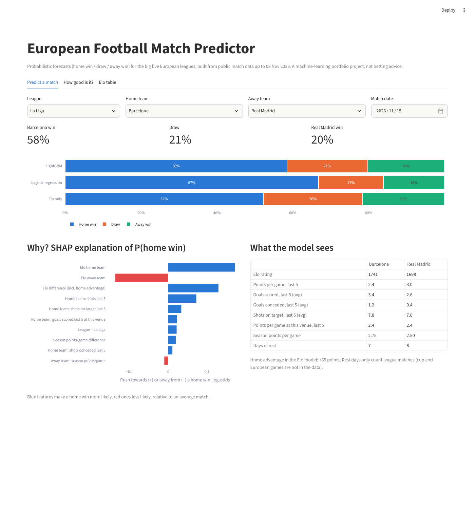
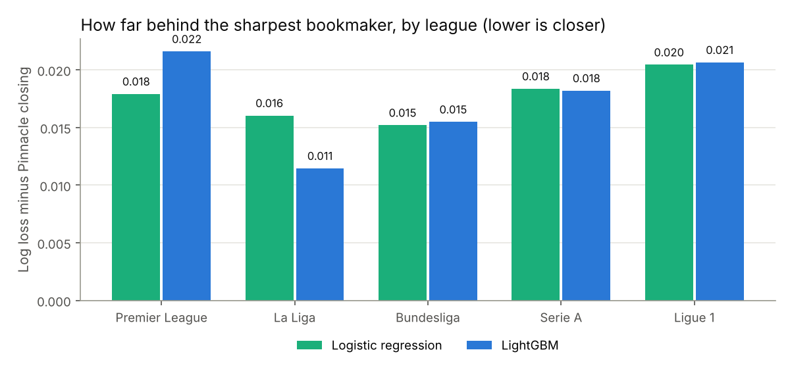
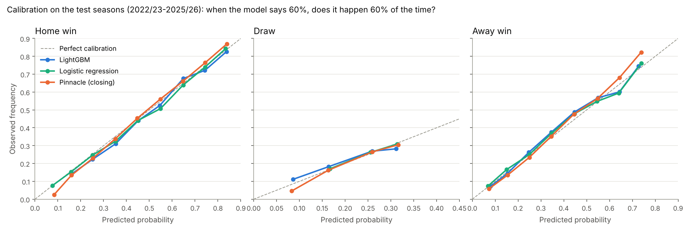
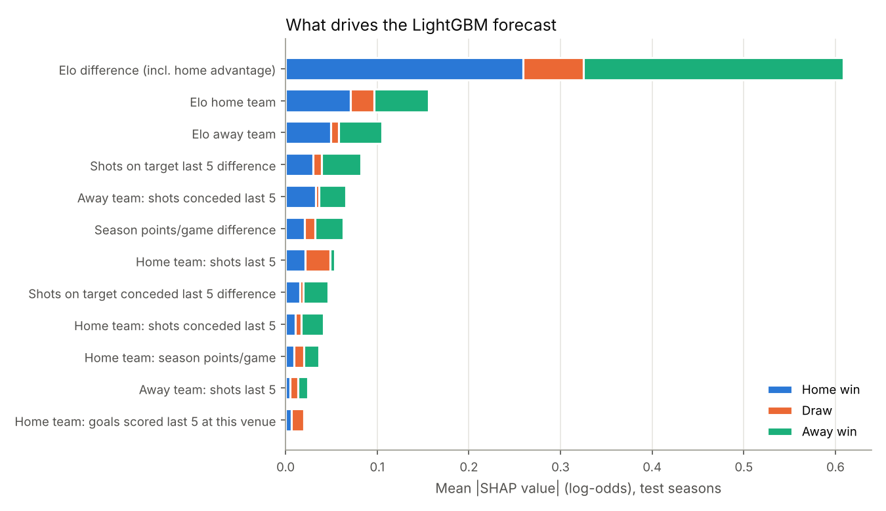
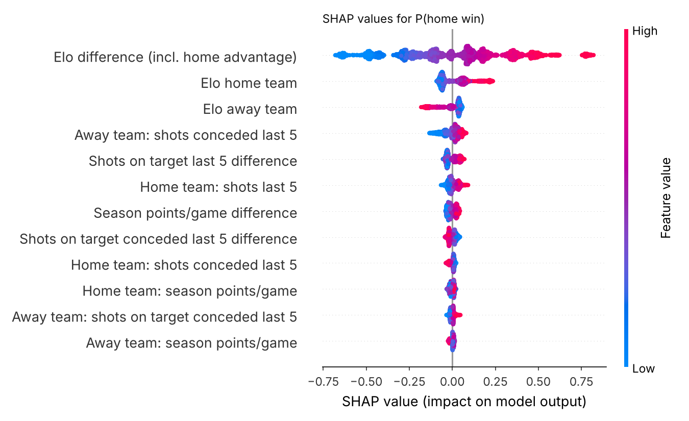
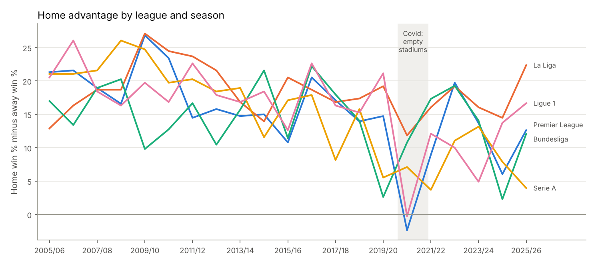
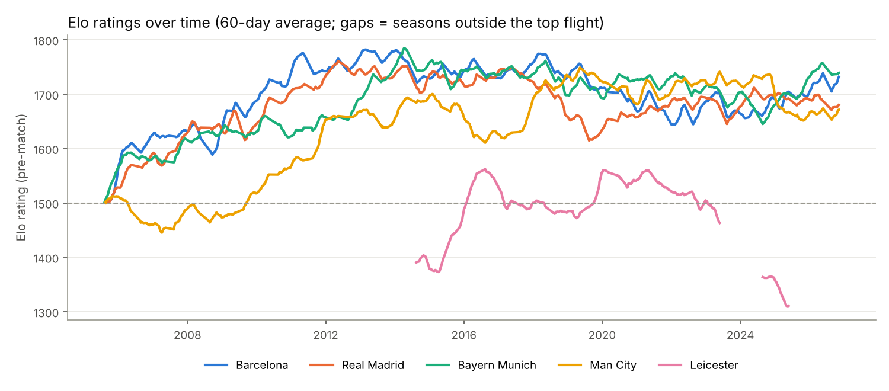

# European Football Match Predictor

**How well can a machine-learning model predict football results in Europe's big five leagues, and how close does it get to the bookmakers?**

This project forecasts the probability of a **home win, draw or away win** for every match in the Premier League, La Liga, Bundesliga, Serie A and Ligue 1, using only free public data. It then benchmarks those probabilities against the sharpest bookmaker in the market, Pinnacle, on four seasons the models never saw.

It is a **probabilistic forecasting** project, not a betting system: the question is how good the probabilities are, not how to make money with them.



## Key results

Out-of-sample test set: seasons **2022/23 to 2025/26**, 6,228 matches that have odds from every bookmaker source. Models were trained on 2008/09 to 2021/22 only.

| Model | Log loss ↓ | Brier ↓ | RPS ↓ | Accuracy |
|---|---:|---:|---:|---:|
| Home-win prior (baseline) | 1.0729 | 0.6492 | 0.2302 | 43.8% |
| Elo only | 0.9830 | 0.5859 | 0.1994 | 52.9% |
| Logistic regression | 0.9806 | 0.5843 | 0.1987 | 53.2% |
| **LightGBM** | **0.9805** | **0.5838** | **0.1984** | **52.9%** |
| Market average (all bookmakers) | 0.9655 | 0.5740 | 0.1940 | 54.2% |
| Pinnacle, opening odds | 0.9651 | 0.5738 | 0.1939 | 54.1% |
| Pinnacle, closing odds | **0.9630** | **0.5725** | **0.1933** | **54.5%** |

**In one sentence:** using only public match data, the best model ends up **0.0175 log loss behind Pinnacle's closing odds** (95% bootstrap CI 0.014 to 0.021), which means it covers about **84% of the distance** between a naive baseline and the sharpest bookmaker in the world.

What else the numbers say:

- **The bookmakers win, as expected.** The gap is small but clearly real: the bootstrap interval is far from zero. Bookmakers see things a results table does not: injuries, line-ups, transfers, and the money of thousands of informed bettors. The closing price, set at kick-off, is the hardest benchmark of all.
- **A well-built Elo rating does most of the work.** A single feature (the Elo difference) already gets to 0.9830. Recent form, shots, rest and venue-specific records only add another 0.0025. SHAP agrees: Elo explains about 55% of the model's decisions.
- **LightGBM and logistic regression are tied** (difference −0.0001, CI −0.0027 to +0.0025). With well-designed features, the relationship is close to linear in log-odds, and a gradient-boosted model has little extra to find. That is a finding, not a failure.
- **Accuracy around 53% is normal.** Football is low-scoring and noisy, and draws (25% of matches) are almost never the most likely outcome, so no model "picks" them. That is why log loss, Brier and calibration matter more than accuracy here.

## How far behind the bookmaker, by league



La Liga is where the model gets closest (0.011 with LightGBM). Ligue 1 is the hardest, and there the Elo-only model actually beats the richer models, a reminder that more features are not always better.

## Calibration



When the model says "60% home win", the home side wins about 60% of the time. Both models track the diagonal closely for all three outcomes, as closely as Pinnacle does for most of the range. Calibration is fine; the gap to the bookmaker comes from **sharpness**: Pinnacle's probabilities are more often confident *and* right.

## What drives the forecast (SHAP)



Mean absolute SHAP value of each feature for the LightGBM model, split by outcome. The Elo difference dominates; shots on target over the last five games are the most useful "form" signal (more useful than goals or points, which are noisier). Rest days and league identity barely matter once Elo is known.



## Home advantage, and what empty stadiums did to it



Home advantage (home win % minus away win %) has been shrinking for two decades. In 2020/21, when matches were played behind closed doors, it **vanished in the Premier League (−2 points) and in Ligue 1 (0)**, and fell in every league: a natural experiment showing that much of home advantage is the crowd. La Liga has the largest home advantage over the whole period (+18 points on average).

## The Elo rating

The Elo system is written from scratch in [`src/fmp/elo.py`](src/fmp/elo.py).

1. Every team starts at 1,500.
2. Before each match, the home team's expected score is
   `E = 1 / (1 + 10^((R_away − (R_home + HFA)) / 400))`
3. After the match both ratings move by `K × G × (S − E)`, where `S` is 1, 0.5 or 0 for a win, draw or loss, and `G` is a margin-of-victory multiplier (a 3–0 counts for more than a 1–0, damped when a big favourite wins big so strong teams don't inflate).
4. Two details matter in leagues with promotion and relegation:
   - A **promoted team** does not start at 1,500 (that would make it an average top-flight side). It inherits the mean rating of the teams relegated the season before.
   - Every summer each rating is pulled **10% back towards the league mean**, because squads change.

The parameters (K = 15, home advantage = 65 Elo points, 10% reversion, margin of victory on) were chosen by grid search on the **training seasons only**, minimising the squared error between the expected and actual score.



## Avoiding data leakage

The golden rule: **a match's features may only use information available before kick-off.** If information from the future leaks in, the model looks brilliant in testing and is useless in reality.

How the pipeline enforces it:

- Matches are reshaped to **one row per team per match** (each match appears twice), so every team has a single chronological history.
- Every rolling statistic is computed on a series **shifted by one match first**: `s.shift(1).rolling(5).mean()`. The value attached to a match is the average of the five matches *before* it.
- Elo ratings are recorded **before** they are updated with the result.
- The split is **temporal**: train on old seasons, test on the most recent ones. Matches are never shuffled.
- Bookmaker odds are used **only as a benchmark**, never as a model input.

And it is tested, not just claimed ([`tests/`](tests/)):

- `test_no_leakage.py` rewrites a match as a 9–0 home win with 60 shots and checks that **the match's own features do not change**, while the features of the teams' *next* matches do.
- `test_serving_matches_training.py` rewinds the demo app to the morning of a real 2024 match and checks that it computes **exactly the same features** as the training pipeline (no training/serving skew).

## Features

For each team, before each match:

| Group | Features |
|---|---|
| Strength | Elo rating of both teams, Elo difference including home advantage |
| Recent form (last 5 league matches) | points, goals scored and conceded, shots, shots on target, both for and against |
| Venue form | the home team's last 5 **home** matches and the away team's last 5 **away** matches: points, goals for and against |
| Season record | points per game so far this season, matches played |
| Context | days of rest since the previous league match (capped at 21), league |
| Differences | home minus away for the main form statistics |

## Data and validation design

- **Source:** [football-data.co.uk](https://www.football-data.co.uk/) — results, match statistics and odds for the top division of England, Spain, Germany, Italy and France, **2005/06 to 2026/27** (38,523 matches; the 2026/27 season is in progress and only used to bring the demo's ratings up to date).
- **Split:**

| Seasons | Role |
|---|---|
| 2005/06 – 2007/08 | Warm-up: Elo and form only, never used to fit models |
| 2008/09 – 2020/21 | Training (23,637 matches) |
| 2021/22 | Validation: regularisation strength, number of trees (early stopping) |
| 2022/23 – 2025/26 | **Test** (7,082 matches), used once at the end |

  After tuning, the models are refit on training + validation before predicting the test seasons.
- **Bookmaker probabilities:** decimal odds are converted with `p = 1 / odds`; the three values add up to more than 1 (the bookmaker's margin, about 2.8% for Pinnacle's closing line and 5% for the market average) so they are divided by their sum. Pinnacle odds stop in January 2026 in the source data, so the main table compares every model on the 6,228 test matches that have all bookmaker prices. On all 7,082 test matches the picture is the same (LightGBM 0.9841 vs market average 0.9691).
- **Metrics:** log loss (heavily punishes confident mistakes), multi-class Brier score, ranked probability score (RPS: calling a draw when the home side wins is a smaller error than calling an away win), accuracy as a reference, calibration curves, and a paired bootstrap (2,000 resamples) for the differences between models.

Full tables by league and by season: [`reports/results.md`](reports/results.md).

## Interactive demo

The Streamlit app lets you pick a league and two teams. It takes their **current** Elo and form from every league match played so far, shows the probabilities from the three models, and explains the LightGBM forecast with SHAP. It uses exactly the same feature code as training.

```bash
streamlit run app/streamlit_app.py
```

## Reproduce everything

```bash
pip install -r requirements.txt
python run_pipeline.py        # download -> clean -> tune Elo -> features -> train -> evaluate -> explain (~2 min)
pytest                        # leakage and train/serve consistency tests
streamlit run app/streamlit_app.py
```

## Project structure

```
├── app/streamlit_app.py        Interactive demo
├── src/fmp/
│   ├── download.py             Fetch the CSV files from football-data.co.uk
│   ├── clean.py                Unify 110 files into one match table (handles renamed odds columns)
│   ├── elo.py                  Elo rating system, written from scratch
│   ├── tune_elo.py             Grid search of Elo parameters on training seasons
│   ├── features.py             Leakage-safe rolling features
│   ├── models.py               Baseline, logistic regression, LightGBM, odds -> probabilities
│   ├── train.py                Temporal split, tuning, refit, test predictions
│   ├── metrics.py              Log loss, Brier, RPS, paired bootstrap
│   ├── evaluate.py             Results tables and calibration / gap charts
│   ├── explain.py              SHAP, home advantage, Elo history charts
│   └── predict.py              Forecast a new fixture (used by the app)
├── tests/                      Leakage and train/serve consistency tests
├── reports/                    results.md, results.json, figures/
├── models/                     Trained models and tuned Elo parameters
└── data/processed/matches.parquet   Clean match table (raw CSVs are downloaded)
```

## Limitations and next steps

- **League matches only.** Cup and European fixtures are missing, so "days of rest" understates fatigue for clubs playing midweek, and form ignores those matches.
- **No team news.** Injuries, suspensions, line-ups and transfers are exactly the information bookmakers have and this model lacks. Squad market values (for example the Transfermarkt dataset) would be a natural next feature.
- **Expected goals (xG).** football-data.co.uk only added xG columns in 2026/27; a longer xG history would likely be a better form signal than shots on target.
- **Draws.** Like every football model, this one almost never makes a draw the single most likely outcome. A dedicated draw model, or a bivariate Poisson goals model (Dixon–Coles), would be an interesting comparison.

## License

Code under the MIT License. Match data © [football-data.co.uk](https://www.football-data.co.uk/), free for personal and research use.
